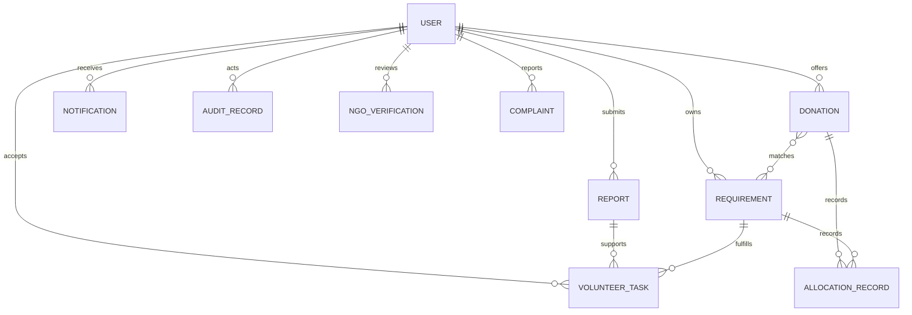

# Data Model

Status: Phase 15. Shared relief services implemented.

## Collections

### `users`

The unified account collection stores `displayName`, normalized unique lowercase
`email`, `role` (`citizen`, `donor`, `volunteer`, `ngo`, `admin`),
`accountStatus`, `emailVerified`, timestamps, and an `auth` subdocument for
credential hashes. Credential fields are `select: false`. NGO users may have
an `organizationProfile`; its submitted details are not proof of verification.

Indexes: unique `email`, then `role + accountStatus`.

### `reports`

Reports reference `reporter` and contain `title`, `description`, `needCategory`,
GeoJSON `location`, optional nonnegative `affectedPersonCount`, requested
resources, urgency, evidence references, review metadata, status, and timestamps.
Statuses are `draft`, `submitted`, `under_review`, `verified`, `rejected`, and
`resolved`. A status value never means that an AI suggestion or self-submitted
evidence is genuine; verification requires a future review workflow.

Indexes: `location` as `2dsphere`, `status + urgency + createdAt`, and
`reporter + createdAt`.

### `requirements`

An NGO requirement references an NGO user and stores resource category,
description, requested/fulfilled/reserved quantities, unit, priority, delivery
area, status, needed-by date, and timestamps. Statuses are `active`, `fulfilled`,
`expired`, and `cancelled`. Schema validation requires fulfilled plus reserved
quantity to be no greater than requested quantity.

Indexes: `deliveryArea` as `2dsphere`, `ngo + status`, and
`status + priority + neededBy`.

### `donations`

Donations reference a donor and store resource category, description, quantity,
reserved and allocated quantities, unit, condition, optional expiry date,
GeoJSON pickup/delivery location, availability status, matched requirement
references, and timestamps. Statuses are `available`, `reserved`,
`partially_allocated`, `allocated`, `expired`, and `cancelled`. Reserved plus
allocated quantity cannot exceed the donated quantity.

Indexes: `location` as `2dsphere`, `donor + availabilityStatus`, and
`resourceCategory + availabilityStatus + createdAt`.

### `volunteertasks`

Tasks reference a `volunteer` (required ObjectId) and optionally a `donation`,
`report`, and `requirement`. They contain:

| Field | Type | Notes |
| --- | --- | --- |
| `volunteer` | ObjectId ref User | Required. Assignment ownership. |
| `donation` | ObjectId ref Donation | Optional linked donation. |
| `report` | ObjectId ref Report | Optional linked report. |
| `requirement` | ObjectId ref Requirement | Optional linked requirement. |
| `assignmentStatus` | string enum | `assigned`, `accepted`, `declined`, `cancelled`, `reassigned`. Default `assigned`. |
| `pickupStatus` | string enum | `pending`, `collected`, `failed`. Default `pending`. |
| `deliveryStatus` | string enum | `pending`, `in_transit`, `delivered`, `failed`. Default `pending`. |
| `assignedLocation` | GeoJSON Point | Required. Exposed only to the assigned volunteer. |
| `taskDetails` | string | Required. Max 3000 chars. |
| `acceptedAt` | Date | Set when volunteer accepts. |
| `collectedAt` | Date | Set when pickupStatus transitions to `collected`. |
| `deliveredAt` | Date | Set when deliveryStatus transitions to `delivered`. |
| `proofOfDeliveryRef` | string | Max 500 chars. Set by volunteer on delivery submission. |
| `history` | array of subdocs | Append-only status change log: `status`, `changedBy`, `changedAt`, `reason`. |

Indexes: `volunteer + assignmentStatus + createdAt` and `deliveryStatus + createdAt`.

#### Task assignment rules

- Tasks are created by coordinators/admins (Phase 15 dependency).
- The `volunteer` field is set at creation and cannot be changed by the volunteer.
- Volunteers cannot self-assign; they can only accept or decline tasks assigned to them.
- Reassignment is a coordinator operation that sets `assignmentStatus: reassigned`.

#### Volunteer-permitted status transitions

```
assignmentStatus:
  assigned   → accepted | declined
  reassigned → accepted | declined

pickupStatus (only when assignmentStatus is accepted):
  pending    → collected | failed

deliveryStatus (only when assignmentStatus is accepted):
  pending    → in_transit
  in_transit → delivered | failed
```

All other transitions are rejected with `409 invalid_transition`.

#### Delivery confirmation

A volunteer submitting `deliveryStatus: delivered` records the submission and
sets `deliveredAt`. Independent confirmation by an NGO or coordinator is required
to mark the task fully complete. No separate confirmation endpoint exists in
Phase 13 — this is a Phase 14+ dependency.

### `allocationrecords`

Durable record of every allocation attempt. Serves two purposes:

1. **Idempotency gate** — a sparse unique index on `idempotencyKey` prevents two
   successful allocations from sharing the same caller-supplied key, even across
   process restarts or multiple server instances. In-memory maps are not used.
2. **Allocation ledger** — every confirmed allocation is queryable here in
   addition to the `auditrecords` collection.

States: `pending` (donation reserved, requirement not yet reserved), `confirmed`
(both steps succeeded), `failed` (step failed; compensation attempted). A
`pending` record older than 5 minutes is considered stale and is compensated by
`recoverStalePendingAllocations()` at startup or on a schedule.

Fields: `donationId`, `requirementId`, `quantity`, `allocatedBy`, optional
`idempotencyKey` (max 120 non-blank characters), `state`, `donationStatus`,
`requirementStatus`, `completedAt`, `failureReason`, timestamps.

Indexes: sparse unique `idempotencyKey`; `donationId + state`;
`requirementId + state`; `state + createdAt` (recovery queries).

### `notifications`

Notifications reference a recipient and contain event type, short title/message,
related entity type and ID, read timestamp, optional expiry, and timestamps.
An expiry TTL index removes expired notifications; delivery is not implemented.

### `auditrecords`

Audit records optionally reference an actor and contain an action, related entity
type/ID, safe metadata, correlation ID, and creation timestamp. They must never
contain passwords, tokens, raw connection strings, or unnecessary personal data.
Indexes support entity history, actor history, and correlation lookup.

### `ngoverifications` and `complaints`

These are separate because NGO verification is an organization review lifecycle,
while complaints target any supported entity and require a reporter. Both retain
reviewer, status, reason, and relevant timestamps. Verification statuses are
`pending`, `approved`, `rejected`, and `suspended`; complaint statuses are
`open`, `under_review`, `resolved`, and `dismissed`.

## Relationships



All references are MongoDB ObjectIds and are not implicit permission grants.
Backend authorization must be enforced when routes are implemented.

## Atomicity, lifecycle, and privacy

- Reservation, allocation, fulfillment, and reassignment operations must use
	conditional atomic updates. Multi-document changes should use MongoDB
	transactions where available, with compensation for external side effects.
- Volunteer task accept/decline use optimistic concurrency: `findOneAndUpdate`
	with the current `assignmentStatus` in the filter prevents double-acceptance.
- Unique email enforcement is a database index concern; normalization happens
	before persistence.
- GeoJSON coordinates are `[longitude, latitude]` and use WGS84-compatible
	decimal degrees. `2dsphere` indexes are used only on location fields.
- Evidence and proof fields are references, not arbitrary uploaded binary data.
- Audit records are append-oriented and privacy-minimized.
- The `assignedLocation` in volunteer tasks should be exposed only to the
	assigned volunteer for the active task, not retained as general history.
